<!-- ═══════════════════ HEADER ═══════════════════ -->
<div align="center">


<a href="https://git.io/typing-svg">
  
</a>

<br/>

<a href="https://www.linkedin.com/in/luis-miguel-narv%C3%A1ez-medina-ba4789254/"></a>
<a href="https://www.instagram.com/luismi_2306/"></a>


</div>

<br/>

<!-- ═══════════════════ TERMINAL ═══════════════════ -->
<div align="center">
  
</div>

<br/>

<!-- ═══════════════════ STACK ═══════════════════ -->
## 🛠️ Stack

<div align="center">


<br/><br/>


</div>

<!-- ═══════════════════ INTERACTIVE ═══════════════════ -->
## 🧭 Explora

<details>
<summary><b>👨‍💻 Sobre mí</b> &nbsp;<sub>(clic para abrir)</sub></summary>
<br/>

- 🎨 Desarrollador **frontend** enfocado en React, TypeScript y Next.js
- 🔗 Trabajo a diario con **Apollo Client + GraphQL** y manejo de caché
- 🧩 Me gusta construir **design systems** y componentes reutilizables
- 🧪 En mi tiempo libre experimento con proyectos por pura curiosidad
- 💬 Hablemos de: UI, arquitectura frontend, DX y rendimiento

</details>

<details>
<summary><b>🚀 Proyectos destacados</b></summary>
<br/>

<div align="center">

<a href="https://github.com/Luism2306/Deal"></a>
<a href="https://github.com/Luism2306/ApiExpressAveonline"></a>
<a href="https://github.com/Luism2306/Zay-shop"></a>

</div>

</details>

<details>
<summary><b>⚡ Lo que estoy haciendo ahora</b></summary>
<br/>

```ts
const now = {
  working: ["Apps React/Next.js con GraphQL", "Componentes de design system"],
  learning: ["Animaciones en UI", "Arquitectura frontend a escala"],
  sideProjects: ["Experimentos web por curiosidad"],
  openTo: ["Colaborar en proyectos frontend", "Charlas sobre React/TS"],
} as const;
```

</details>

<!-- ═══════════════════ STATS ═══════════════════ -->
## 📊 Actividad

<div align="center">


<br/>


<br/><br/>


</div>

<!-- ═══════════════════ SNAKE ═══════════════════ -->
## 🐍 Contribuciones

<div align="center">
<picture>
  <source media="(prefers-color-scheme: dark)" srcset="https://raw.githubusercontent.com/Luism2306/Luism2306/output/github-snake-dark.svg" />
  <source media="(prefers-color-scheme: light)" srcset="https://raw.githubusercontent.com/Luism2306/Luism2306/output/github-snake.svg" />
  
</picture>
</div>

<!-- ═══════════════════ FOOTER ═══════════════════ -->

